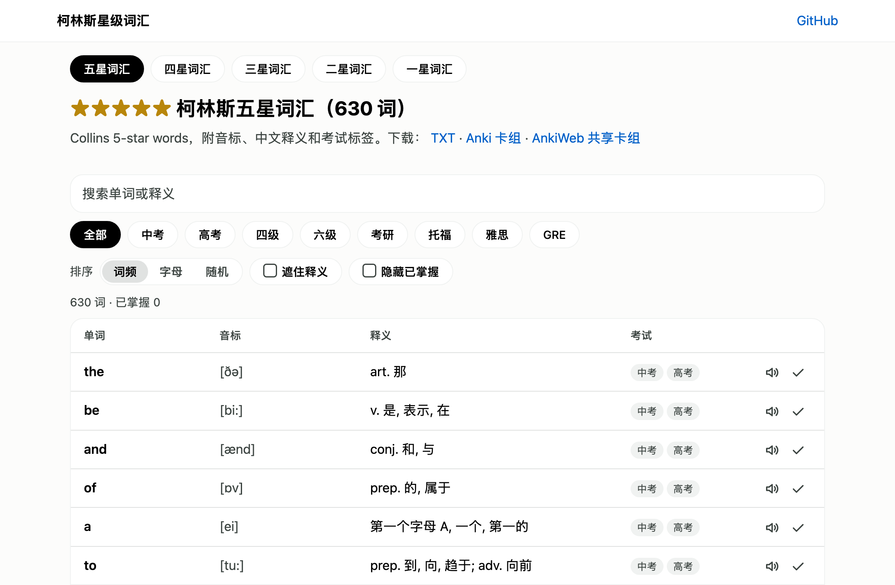

# 柯林斯星级词汇 · Collins Star Vocabulary

按柯林斯星级分组的 13,633 个英语单词，附音标和简短中文释义，可在线查询，也可下载 TXT、CSV、JSON 和 Anki 卡组。

13,633 English words grouped by Collins star level, with phonetics and short Chinese definitions.

## 在线查询

**<https://cd155.github.io/collins-vocabulary/>**

[](https://cd155.github.io/collins-vocabulary/)

无需下载，打开即可使用：

- 按星级浏览，搜索单词或释义
- 按考试筛选：中考、高考、四级、六级、考研、托福、雅思、GRE
- 按词频、字母或随机排序
- 遮住释义自测，标记已掌握的单词
- 朗读单词
- 听写：逐个朗读单词，按设定的间隔停顿，可暂停，可选择是否显示单词

## 下载

| 星级 | 词数 | 文本 | Anki 卡组 | AnkiWeb 共享卡组 |
|---|---:|---|---|---|
| ★★★★★ 五星 | 630 | [collins_5_star.txt](lists/collins_5_star.txt) | [collins_5_star.apkg](lists/collins_5_star.apkg) | [1403111213](https://ankiweb.net/shared/info/1403111213) |
| ★★★★ 四星 | 1,009 | [collins_4_star.txt](lists/collins_4_star.txt) | [collins_4_star.apkg](lists/collins_4_star.apkg) | [1544157144](https://ankiweb.net/shared/info/1544157144) |
| ★★★ 三星 | 1,418 | [collins_3_star.txt](lists/collins_3_star.txt) | [collins_3_star.apkg](lists/collins_3_star.apkg) | [1539836752](https://ankiweb.net/shared/info/1539836752) |
| ★★ 二星 | 3,036 | [collins_2_star.txt](lists/collins_2_star.txt) | [collins_2_star.apkg](lists/collins_2_star.apkg) | [459912606](https://ankiweb.net/shared/info/459912606) |
| ★ 一星 | 7,540 | [collins_1_star.txt](lists/collins_1_star.txt) | [collins_1_star.apkg](lists/collins_1_star.apkg) | [1163764613](https://ankiweb.net/shared/info/1163764613) |
| 合计 | 13,633 | [collins.csv](lists/collins.csv) · [collins.json](lists/collins.json) | | |

## 柯林斯星级

柯林斯英语词典用一到五颗星标注单词的常用程度，五星词最常用，学习者通常从五星词开始逐级往下学。

## 文件格式

### TXT

每个星级一个文件。每行一个单词，以制表符分隔：单词、`[音标]`、释义。

```text
about	[ә'baut]	prep. 在...周围, 大约, 有关, 关于; adv. 大约, 四处, 在附近, 周围
```

`Vocabulary_Lists/` 是词表原来的路径，为了让旧链接继续可用而保留，内容与 `lists/` 中的 `.txt` 相同。

### CSV 和 JSON

`collins.csv` 和 `collins.json` 包含全部星级，字段如下：

| 字段 | 含义 |
|---|---|
| `word` | 单词 |
| `stars` | 星级，1 到 5 |
| `phonetic` | 音标 |
| `translation` | 中文释义 |
| `tags` | 收录该词的考试，见下表 |
| `bnc` | 在英国国家语料库中的词频排名，1 为最常用；没有排名时为空 |
| `frq` | 在当代语料库中的词频排名，1 为最常用；没有排名时为空 |

`tags` 的取值：

| 标签 | `zk` | `gk` | `cet4` | `cet6` | `ky` | `toefl` | `ielts` | `gre` |
|---|---|---|---|---|---|---|---|---|
| 考试 | 中考 | 高考 | 四级 | 六级 | 考研 | 托福 | 雅思 | GRE |

### Anki 卡组

每个星级一个 `.apkg` 文件。

- **导入**：在 Anki 中选择「文件 → 导入」。导入新版本会更新已有卡片，不会重复添加。
- **卡片**：正面为单词和音标，背面为释义。
- **标签**：每张卡片带有上表中的考试标签，可在 Anki 中按标签筛选，例如只学五星词中的四级词汇。

### 释义

释义保留每个词性的前几个义项。约 150 个生僻或专业词汇只有带领域标记的释义，如 `[医]`（医学）、`[计]`（计算机）。

## 数据来源

星级、音标和释义均来自开源英汉词典 [ECDICT](https://github.com/skywind3000/ECDICT)（MIT 许可）。如发现单词有误，请到 ECDICT
反馈；本仓库的词表由它重新生成。

## 重新生成词表

```bash
mkdir -p data
curl -L -o data/ecdict.csv https://raw.githubusercontent.com/skywind3000/ECDICT/master/ecdict.csv
pip install -r requirements.txt
python build.py
```

`build.py` 生成 `lists/` 和 `Vocabulary_Lists/` 中的全部文件。

`python site.py` 根据 `lists/collins.json` 把网站生成到 `_site/`。每次推送到 `master` 且词表或 `site.py` 有改动时，工作流会自动把网站部署到
GitHub Pages。

## 许可

[MIT](LICENSE)
